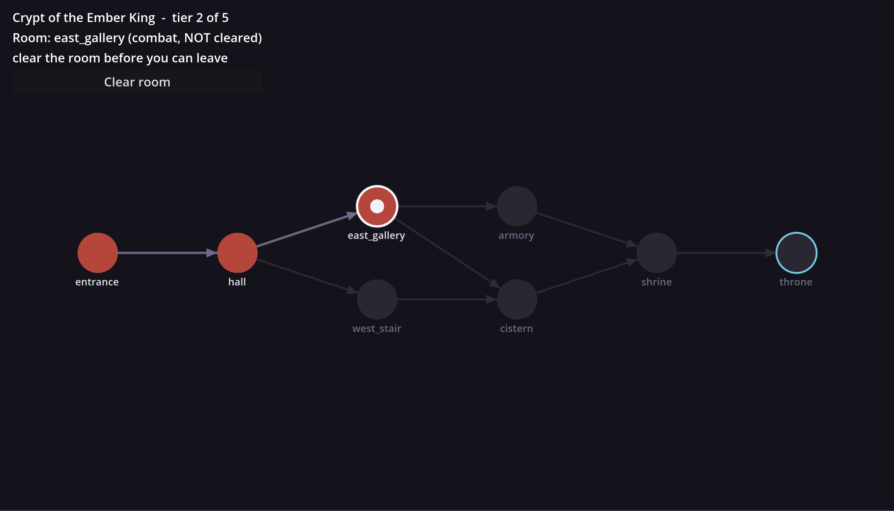

# DungeonDelver

A small dungeon-crawler built in Godot 4.7 with C# / .NET.

Dungeons are defined as JSON map files (`godot/maps/`) and loaded into a room graph
at runtime — rooms are nodes, exits are directed edges, and combat rooms have
to be cleared before you can move on.

## Layout

- `godot/maps/` — dungeon map files (JSON)
- `godot/src/Model/Dungeon/` — `Room`, `CombatRoom`, `ShopRoom`, `DungeonMap` and the loader
- `godot/src/Model/Creatures/` — player and monsters, with their data classes
- `godot/src/Model/Abilities/` — abilities
- `godot/src/Scenes/` — Godot scenes
- `godot/src/Simulation/` — simulation harness
- `tests/DungeonDelver.Tests/` — xUnit tests (plain C#, run outside the Godot runtime)

## Running

Open the project in Godot 4.7 (with .NET support) or Rider and run it.
